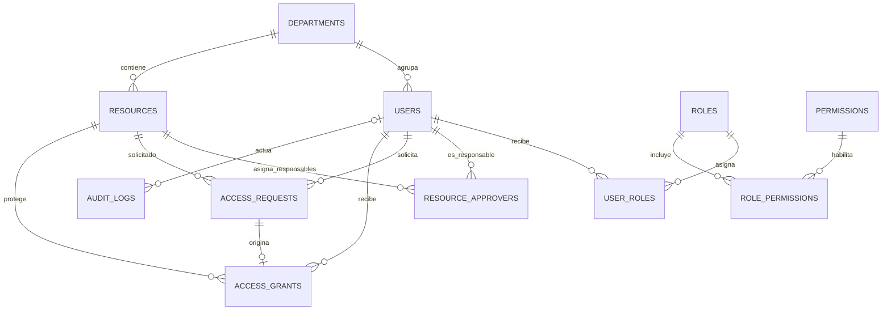

# YESIAM — Modelo entidad-relación

**Versión:** 0.3 — Diseño preliminar de MySQL 8  
**Estado:** Pendiente de validación mediante migraciones y pruebas

## 1. Modelo lógico

El diagrama resume vínculos principales. Existen referencias adicionales a los usuarios que toman decisiones, conceden o revocan accesos.

## 2. Tablas y campos principales

| Tabla | Campos clave | Objetivo |
| --- | --- | --- |
| `departments` | `id` PK, `name`, `code` UNIQUE, `is_active` | Áreas de una organización. |
| `users` | `id` PK, `department_id` FK, `name`, `email` UNIQUE, `password`, `status`, `last_login_at` | Identidades; contraseña hasheada. |
| `roles` | `id` PK, `name`, `code` UNIQUE | Roles globales. |
| `permissions` | `id` PK, `name`, `code` UNIQUE | Capacidades funcionales. |
| `user_roles` | `user_id` FK, `role_id` FK, UNIQUE(`user_id`,`role_id`) | Relación N:M. |
| `role_permissions` | `role_id` FK, `permission_id` FK, UNIQUE(`role_id`,`permission_id`) | Relación N:M. |
| `resources` | `id` PK, `department_id` FK, `name`, `description`, `protected_content`, `status` | Recursos internos protegidos. |
| `resource_approvers` | `resource_id` FK, `user_id` FK, UNIQUE(`resource_id`,`user_id`) | Responsables asignados. |
| `access_requests` | `id` PK, `requester_id` FK, `resource_id` FK, `justification`, `status`, `decided_by` FK NULL, `decided_at`, `decision_note` | Flujo de decisiones. |
| `access_grants` | `id` PK, `user_id` FK, `resource_id` FK, `source_request_id` FK, `granted_by` FK, `granted_at`, `revoked_by` FK NULL, `revoked_at` | Concesiones, incluidas las históricas. |
| `audit_logs` | `id` PK, `actor_user_id` FK NULL, `action`, `entity_type`, `entity_id`, `metadata`, `ip_address`, `created_at` | Eventos de seguridad. |

## 3. Convenciones

- Las claves primarias iniciales serán `BIGINT UNSIGNED` autoincrementales, conforme a migraciones Laravel.
- Las claves foráneas llevarán índices y restricciones; no se utilizará borrado en cascada sobre registros históricos críticos.
- Laravel gestionará `created_at` y `updated_at` en las tablas transaccionales pertinentes.
- Los campos de estado tendrán valores definidos mediante validaciones y, cuando convenga, restricciones SQL.
- El acceso a `protected_content` requerirá una concesión activa; **administrar el recurso no implica permiso de lectura**.

## 4. Consistencia e historial

- Una solicitud aprobada se conserva como registro histórico, aunque su concesión sea revocada.
- La aprobación y la concesión deben confirmarse en una transacción.
- Se impedirá la duplicación de concesiones activas mediante una estrategia transaccional y una restricción o diseño equivalente compatible con MySQL 8.
- La auditoría evita guardar contraseñas, tokens y secretos.
- Los eventos auditables deben generarse en el backend; no se confiará en registros enviados por Angular.

## 5. Pendientes de diseño físico

- Confirmar longitud y nulabilidad de cada columna.
- Definir índices para búsquedas de auditoría y solicitudes.
- Decidir cómo gestionar contenido de recursos y futuras versiones.
- Especificar la implementación exacta de una sola concesión activa por usuario/recurso.
- Determinar política de conservación de registros y anonimización de datos ficticios.

Este documento es una base de diseño, **no** un esquema SQL ya desplegado.
